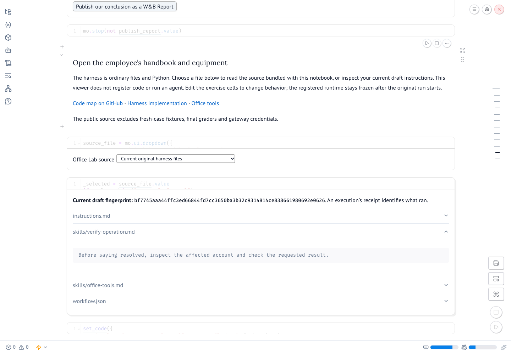

# Please Improve Yourself

Your manager has hired an autonomous employee for billing and onboarding. You supply its instructions, tools and checks. Then your manager asks whether an agent could improve those too.

Build the employee in a Forge Notebook, run its tools in Sandboxes, and inspect each completed attempt in Agent Lens. Compare the original and revised harnesses on fresh cases before deciding what to keep. The company, accounts and payments are fictional; the code and execution records are real.

[Open the code map](code-map.md) for the harness, office simulator, instrumentation and improvement controller. The notebook also has an **Office Lab source** viewer. You can read the implementation without a gateway connection.

## Run the notebook

[Open the Forge notebook](https://forge.coreweave.com/notebooks/Tm90ZWJvb2s6MTU2ODc=) or use the checkout below. Use **Copy to project** to make your own working copy in a project you can write, then open **Edit**. Your destination team must have hosted Notebook/Sandbox access. The public template does not grant that entitlement. [Complete setup](hosted-setup.md).

Install [uv](https://docs.astral.sh/uv/getting-started/installation/). These commands are the same in macOS/Linux terminals and Windows PowerShell:

```sh
git clone https://github.com/ash0ts/pending-inc-workshop.git
cd pending-inc-workshop
uv sync --frozen
uv run python check_setup.py
uv run marimo edit office_notebook.py
```

Python 3.11–3.13 is supported; uv can install it. No Docker, Node, Electron or local gateway is required. Keep this checkout private once you add your own notes or results.

Open in **Edit** mode. If only text and inactive code appear, use the bottom-right Run button once to initialize the notebook. Initialization makes no provider or Sandbox calls. Edit the visible Python cells, run their local checks, and use the explicit buttons for paid work. The tool, dispatcher, observation builder, span instrumentation, development scorer, judge validator and improvement controller are yours to implement. Worked answers are available on request in each chapter.

## Connect

In Forge, copy the notebook into a project you can write. The runtime supplies credentials and the notebook fills in that project's `team/project` value. The hosted workshop gateway address is also prefilled for its advertised time window. Paste the attendee token and gateway access token supplied by your host into the password fields, then click **Check connection**. No personal API key is needed for the normal hosted path.

On a laptop, authenticate with `uv run wandb login`. Never put credentials in source cells or saved outputs. If your account cannot read the template or launch a notebook, ask the host to check access before the workshop.

The gateway controls model quota and tool execution. Its connection receipt states whether it uses remote CoreWeave Sandboxes or the local fallback. Your own Forge credentials publish your traces and evaluation rows. Setup checks project read access; the setup trace checks trace readback and evaluation write access. Do not use the operator repository: it contains private grading material.

## What you will change

1. Write `lookup_invoice` and its input schema. Test the same invoice on two accounts.
2. Add a Forge tool span before the first model run. The registered-tool test exports its real lookup calls to Agent Lens.
3. Complete dispatch and append the returned observation to the next request. Register the tested source; the runtime freezes when the original execution opens.
4. Follow the original, manual and candidate attempts through Agent Lens. Compare stored spans with independently saved requests/events.
5. Write a state scorer and a structured explanation judge; publish development EvalTables.
6. Select an event from your run, describe the change you expect, and edit one harness procedure. Save and test it with one action.
7. Complete the probe code, then follow the workbench’s next action through proposals, tests, composition and reflection.
8. Carry a cited lesson into onboarding; freeze and compare three versions on four fresh cases.

The improvement workbench follows saved progress; there are no round or phase dropdowns. Read the candidate diff above its test button. Disabled actions say what is missing and link to that step.

The model stays fixed. The final comparison changes harness files only. Participant development scores and the protected final grader are labeled separately.

## If a request or export stops

Refresh and reconnect using the same attendee token and project. Reuse the same action: completed inference is read from the gateway, not issued again. Source changes after the runtime freeze are rejected. Export/readback retries do not run the employee. Keep `.pending-code/journal` when moving this checkout; it contains trace and publication receipts, not credentials.

A partially exported trace can require repair. Do not run the employee again to repair telemetry. Preserve its audit record and ask the facilitator to inspect the failed export.

## Inspect your code and results

The **Office Lab source** viewer opens your draft instructions and the Python behind the harness, tools and improvement controller. The code map links to the same files on GitHub.



Native EvalTables publication is currently returning HTTP 500. Use the notebook’s case-by-case score table and saved Weave evaluations to compare your results. Agent Lens links connect each completed attempt to its tool activity. The final Report preserves your conclusion and evidence; publication retries reuse saved executions.

Local tool, message-handoff, timeout and scorer exercises work without a provider connection. Model runs and remote Sandbox tests need your workshop connection.
