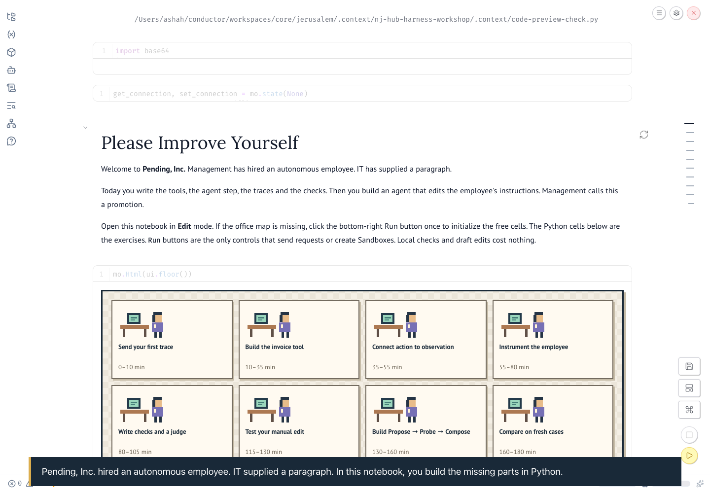
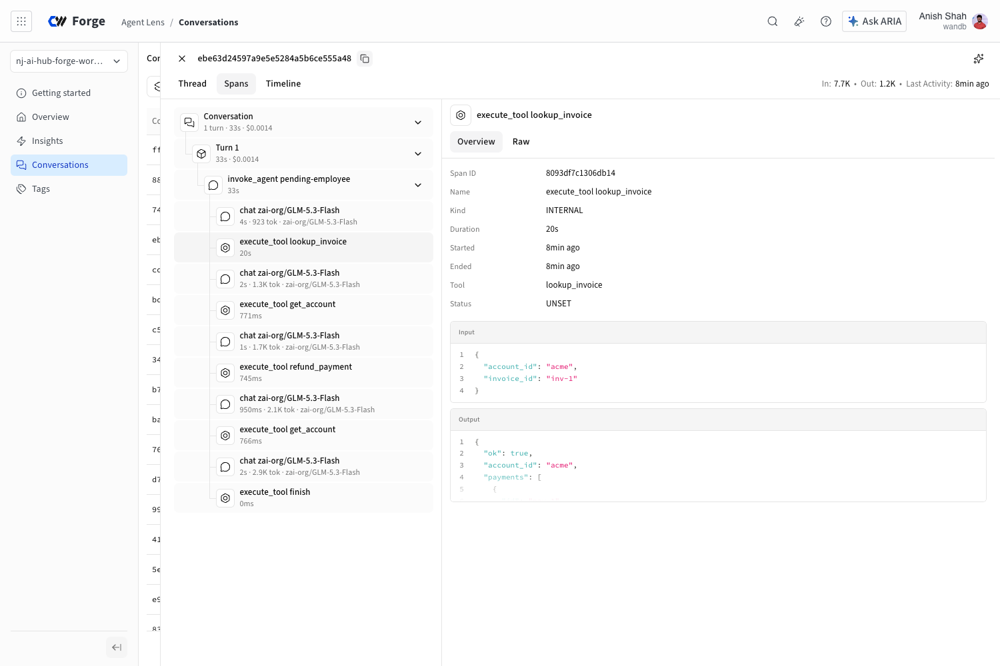

# Please Improve Yourself

Build the employee, instrument it, then build the agent that edits its harness.

## Run the notebook

[Open the Forge notebook](https://forge.coreweave.com/notebooks/Tm90ZWJvb2s6MTU2ODc=) or use the checkout below. Use **Copy to project** to make one working copy per pair in a project you can write, then open **Edit**. Your destination team must have hosted Notebook/Sandbox access. The public template does not grant that entitlement. [Complete setup](hosted-setup.md).

Install [uv](https://docs.astral.sh/uv/getting-started/installation/). These commands are the same in macOS/Linux terminals and Windows PowerShell:

```sh
git clone https://github.com/ash0ts/pending-inc-workshop.git
cd pending-inc-workshop
uv sync --frozen
uv run python check_setup.py
uv run marimo edit office_notebook.py
```

Python 3.11–3.13 is supported; uv can install it. No Docker, Node, Electron or local gateway is required. Keep this checkout private once you add your own notes or results.

Open in **Edit** mode. If only text and inactive code appear, use the bottom-right Run button once to initialize the notebook. Initialization makes no provider or Sandbox calls. Edit the visible Python cells, run their local checks, and use the explicit buttons for paid work. The tool, dispatcher, observation builder, span instrumentation, development scorer, judge validator and improvement controller are yours to implement. Worked answers are available on request in each chapter.

## Connect

In Forge, copy the notebook into a project you can write. The runtime supplies credentials and the notebook fills in that project's `team/project` value. The hosted workshop gateway address is also prefilled for its advertised time window. Paste the pair token and gateway access token supplied by your host into the password fields, then click **Check connection**. No personal API key is needed for the normal hosted path.

On a laptop, authenticate with `uv run wandb login`. Never put credentials in source cells or saved outputs. If your account cannot read the template or launch a notebook, ask the host to check access before the workshop.

The gateway controls model quota and remote Sandboxes. Your own Forge credentials publish your traces and evaluation rows. Setup checks project read access; the setup trace checks trace readback and evaluation write access. Do not use the operator repository: it contains private grading material.

## What you will change

1. Write `lookup_invoice` and its input schema. Test the same invoice on two accounts.
2. Complete tool dispatch and append the returned observation to the next request.
3. Register the tested source. The runtime freezes when the original execution opens.
4. Add Forge tool spans; compare stored spans with independently saved requests/events.
5. Write a state scorer and a structured explanation judge; publish development EvalTables.
6. Edit one harness procedure, then implement two candidate probes and composition.
7. Carry a cited lesson into onboarding; freeze and compare three versions on four fresh cases.

The model stays fixed. The final comparison changes harness files only. Participant development scores and the protected final grader are labeled separately.

## If a request or export stops

Refresh and reconnect using the same pair token and project. Reuse the same action: completed inference is read from the gateway, not issued again. Source changes after the runtime freeze are rejected. Export/readback retries do not run the employee. Keep `.pending-code/journal` when moving this checkout; it contains trace and publication receipts, not credentials.

A partially exported trace can require repair. Do not run the employee again to repair telemetry. Preserve its audit record and ask the facilitator to inspect the failed export.

## Recorded path

Local tool, message-handoff, timeout and scorer exercises require no provider connection. **Open recorded development evidence** shows the code-first rehearsal using worked answers. Your new edits did not produce those recorded results. The replay includes no fresh-case fixtures or final grader.

## Preview and access



[Watch the earlier captioned walkthrough](preview/pending-code.mp4) · [Captions](preview/pending-code.vtt). It records the previous release; its results are historical.

The current browser rehearsal completed both improvement rounds, all twelve fresh executions and all twelve explanation judgments. All three versions passed four state checks; both compositions retained the manual harness. No quality gain is claimed. [Browser check summary](browser-validation.json).

Native EvalTables publication remains unavailable (HTTP 500). The notebook shows the saved Weave evaluations, W&B artifacts and Report so publication failure does not strand your work. Agent Lens conversations and tool spans were checked in Chrome.

The shared gateway runs in an operator-owned CoreWeave Sandbox with protected HTTPS and a fixed lifetime shown in the notebook. State backups are private. The notebook includes a case-by-case score table and saved Weave links when native EvalTables is unavailable. Access from an external attendee account, 25-pair timing and a human learning rehearsal are separate release checks.


